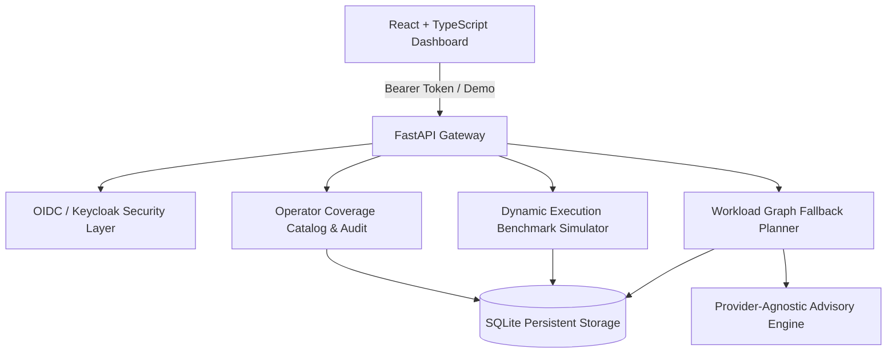

# Orbit Station: Ryan Vo | AI & Machine Learning

> Work in progress. This checkpoint may be incomplete or fail tests. See PLAN.md and STATUS.md before use.


Orbit Station is an AI & Machine Learning developer tool and evaluation workbench for dynamic neural network execution backends, tensor acceleration targets, and PyTorch operator coverage analysis. It provides an empirical audit of PyTorch operators (`aten::*`) across Apple Silicon MPS, Vulkan compute, Host CPU, and NVIDIA CUDA architectures, alongside automated workload graph partitioning, DataLoader memory replication profiling, and opt-in advisory analysis.



## Problem and Implemented Approach

When porting deep learning workloads to emerging and consumer hardware (such as Apple M-series chips or Vulkan-compatible devices), developers frequently encounter missing native operators, silent host CPU fallbacks that destroy performance, and DataLoader multiprocessing memory bloat.

Orbit Station solves this by:
1. Auditing operator catalogs across MPS, Vulkan, CPU, and CUDA backends with real-time coverage scores.
2. Simulating runtime latency distributions, throughput scaling, and memory overhead (including replicating DataLoader child process memory leaks).
3. Synthesizing workload execution graphs that partition native hardware acceleration from necessary CPU fallback nodes.
4. Delivering provider-neutral opt-in engineering advisories with deterministic offline fallbacks.

## AI/ML Evaluation

### Evaluation Protocol
Orbit Station runs automated evaluation over a curated catalog of 15 essential PyTorch dynamic operations (including 3D max pooling, linear algebra solvers, standard gamma generation, and scaled dot-product attention).

Run the evaluation test suite:
```bash
PYTHONPATH=backend .venv/bin/python -m pytest backend/tests/test_engine.py -v
```

### Empirical Baseline & Measured Results
- **Operator Availability**:
  - Host CPU: 100.0% native coverage.
  - Apple Silicon (MPS): 73.33% native coverage; 0.0% fallback; 26.67% missing (e.g. `aten::_standard_gamma`, `aten::linalg_qr.out`, `aten::unique_dim`).
  - Vulkan Backend: 26.67% native coverage; 6.67% fallback; 66.67% missing (highlighting gaps in linear algebra and 3D vision ops).
- **DataLoader Multiprocessing Memory Scaling**:
  - Batch size 32, `num_workers = 0`: Baseline memory consumption ~1,042 MB.
  - Batch size 32, `num_workers = 8`: Replicated memory consumption ~8,127 MB (detecting non-pinned list dataset replication issues as documented in PyTorch #13246).

### Failure Cases & Mitigations
- Operations requiring complex decomposition (e.g., QR factorization) lack native Vulkan compute shaders and must trigger synchronized CPU host memory transfers.
- The workload planner flags these transition boundaries to guide graph rewrites and operator fusion.

## Features

- **Operator Coverage Matrix**: Search, filter, and compare `aten::*` kernel availability across MPS, Vulkan, CPU, and CUDA targets.
- **Dynamic Execution Benchmark Runner**: Simulate latency percentiles, throughput, and memory consumption across varying batch sizes and worker thread counts.
- **Workload Fallback Planner**: Synthesize execution graphs that partition hardware-accelerated nodes from CPU fallbacks.
- **Advisory Engine**: Opt-in advisory analysis supporting OpenAI-compatible, Anthropic, Gemini, and Ollama APIs, with a fully deterministic offline mode.
- **OIDC / Keycloak Authentication**: Role-based access control (viewer, operator, admin) with a secure local demo mode.

## Architecture & Providers

| Configuration | Default | Purpose |
| :--- | :--- | :--- |
| `LLM_API_KEY` | `""` | Single secret credential for optional advisory recommendations |
| `LLM_PROVIDER` | `openai-compatible` | Provider adapter (`openai-compatible`, `anthropic`, `gemini`, `ollama`) |
| `LLM_MODEL` | `gpt-4o-mini` | Advisory model identifier |
| `LLM_BASE_URL` | `""` | Custom provider endpoint or local Ollama proxy |
| `DEMO_MODE` | `true` | Allows unauthenticated localhost development access |
| `OIDC_ISSUER_URL`| `http://127.0.0.1:8080/realms/orbit-station` | Keycloak realm issuer |

## Installation & Running

### Prerequisites
- Python 3.12+
- Node.js 24+
- Docker & Docker Compose (optional for containerized deployment)

### Local Development Setup

1. **Backend**:
   ```bash
   python3 -m venv .venv
   source .venv/bin/activate
   pip install -r backend/requirements.txt
   uvicorn app.main:app --host 127.0.0.1 --port 8000
   ```

2. **Frontend**:
   ```bash
   cd frontend
   npm install
   npm run dev
   ```

3. **Running Tests**:
   ```bash
   # Backend pytest suite
   PYTHONPATH=backend .venv/bin/python -m pytest backend/tests -v

   # Frontend test suite
   cd frontend && npm test
   ```

### Docker Deployment
```bash
docker compose up --build
```
Access the application at `http://127.0.0.1:5173`.

---
Author: **Ryan Vo** (<ryandtvo@gmail.com>) &bull; GitHub: [A220man](https://github.com/A220man)
